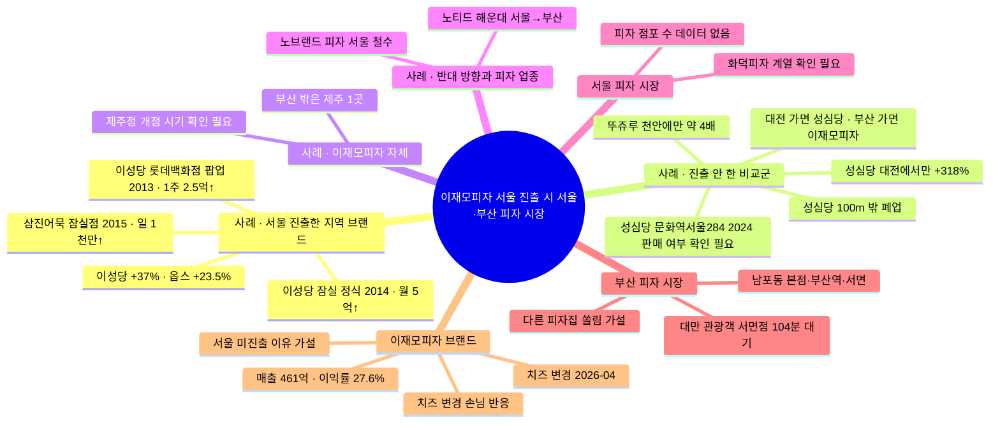

# 키워드 맵 · 이재모피자가 서울에 진출하면 서울·부산 피자 시장은?

> 기준일: 2026-11-13. 주제를 바꾸면서 새로 만들었습니다. 이전 주제('왜 사람이 몰리나')로 만든 맵은 [research/2026-11-13-keyword-map-이전주제.md](./research/2026-11-13-keyword-map-이전주제.md)에 보존했습니다.
> **비슷한 사례를 키워드의 절반 넘게** 배치했습니다(22개 중 13개). 아직 일어나지 않은 서울 진출을 '이미 일어난 비슷한 일'로 추정하는 주제라서입니다.
> 'URL에서 확인'은 2026-11-13에 원문 페이지를 직접 열어 읽은 것입니다. 비즈워치·위키트리 기사는 이전 맵 작업(같은 날)에서 연 것을 다시 씁니다. 기사 보도치이며 공시(DART)와는 대조하지 않았습니다.

## 가운데 질문

이재모피자가 서울에 매장을 내면 ① 서울 피자 시장에서는 누구의 손님을 얼마나 가져가고, 그 효과는 오래가나? ② 부산에서는 '부산에 가야 먹는' 수요와 본점 주변 상권이 어떻게 변하나?

## 근거 등급

| 상태 | 뜻 |
|---|---|
| 파일에서 확인 | `inputs/` CSV의 해당 데이터 행에서 값을 직접 읽음 |
| URL에서 확인 | 원문 페이지를 직접 열어 확인함 |
| 확인 필요 | 검색 결과 요약만 봤거나, 출처끼리 엇갈리거나, 원문이 열리지 않음 |
| 가설 | 회사·기관이 밝히지 않은 이유나 아직 데이터로 보지 않은 추정 |

## 키워드 표

| 묶음 | 분류 | 키워드 | 왜 골랐나 (셀 것 / 주제 연결) | 근거 (URL 또는 CSV 행) | 노트 | 상태 |
|---|---|---|---|---|---|---|
| **사례 · 지역 브랜드의 서울 진출** | 산업 | 이성당 롯데백화점 팝업 (2013-04) | 정식 매장 전 '시험 진출'의 첫 반응 크기. 일주일 2억5천만원 이상, "3시간 이상" 대기. → 이재모피자도 팝업부터 할 경우의 기준값 | [시대일보 2014-05-01](https://www.sidae.com/article/2014050111028094585), [뉴데일리 2020-04-21](https://biz.newdaily.co.kr/site/data/html/2020/04/20/2020042000224.amp.html)(장소) | 개점 초기 효과이며 지속 효과가 아님. 팝업 장소는 시대일보에 없고, 뉴데일리 2020만 "롯데백화점 본점"이라고 씀 | URL에서 확인 |
| 사례 · 지역 브랜드의 서울 진출 | 산업 | 이성당 잠실점 (2014-05) | 군산 본점 밖 첫 매장(약 270㎡). 이후 "월평균 5억원 이상" 매출. → 개점 1년 뒤에도 유지됐나를 보는 '지속성' 근거 | 위 시대일보 기사(개점), [디지털타임스 2015-05-10](https://www.dt.co.kr/article/10940527)(월평균 매출) | 백화점 쪽 발표 수치. 군산 본점 매출 변화는 기사에 없음 | URL에서 확인 |
| 사례 · 지역 브랜드의 서울 진출 | 산업 | 삼진어묵 잠실점 (2015-04) | **부산 브랜드의 서울 진출이라 가장 가까운 사례.** 부산본점 월평균 2억5천만원, 잠실점 하루 평균 1천만원 이상. → 서울 매장이 부산 본점 매출을 넘을 수 있다는 근거 | [디지털타임스 2015-05-10](https://www.dt.co.kr/article/10940527) | 여기서 '부산본점'은 기사 원문상 '롯데백화점 부산본점' 매장으로 읽힘. 영도 본점과 구분 필요 | URL에서 확인 |
| 사례 · 지역 브랜드의 서울 진출 | 산업 | 옵스 | 서울·수도권에 나간 브랜드의 2021→2025 매출: 이성당 217억→298억원(+37%), 옵스 +23.5%. → 진출한 쪽의 성장률 | [아시아경제 2026-04-16](https://view.asiae.co.kr/en/article/2026041514303575692) | 영문판 기사. 옵스의 수도권 매장이 서울 안인지는 원문 표현이 모호해 **매장 위치는 확인 필요** | URL에서 확인 (매장 위치는 확인 필요) |
| **사례 · 진출하지 않은 브랜드 (비교군)** | 산업 | 성심당 | 같은 기간 매출 629억→2,629억원(+318%), 직원 476→1,000명. 진출한 이성당(+37%)·옵스(+23.5%)와 비교. → "진출 안 하는 게 더 크게 큰다"는 비교의 핵심 | [아시아경제 2026-04-16](https://view.asiae.co.kr/en/article/2026041514303575692) | 성장률 차이를 서울 진출 여부 하나로 설명할 수 없음(브랜드 규모·업종 차이) | URL에서 확인 |
| 사례 · 진출하지 않은 브랜드 | 산업 | 성심당 서울 팝업 (2024) | 정식 매장 없이 팝업만 한 경우. → 이재모피자의 '팝업만' 시나리오 | 아시아경제 2026-04-16(위 URL)에 팝업 언급, [헤이팝 2024-05-22](https://heypop.kr/n/98195)(장소·기간) | 문화역서울284, 2024-05-17~06-02 전시 〈로컬 크리에이티브 2024〉. 아시아경제는 'pop-up store'라 쓰지만 헤이팝은 전시로 소개하며 판매 이야기가 없음. **판매 여부 확인 필요** | 확인 필요 |
| 사례 · 진출하지 않은 브랜드 | 산업 | 뚜쥬루 | 천안에만 있으면서 매출 88억→315억원(약 4배). 성심당 말고도 '안 나가는' 사례가 있다는 근거 | [아시아경제 2026-04-16](https://view.asiae.co.kr/en/article/2026041514303575692) | | URL에서 확인 |
| 사례 · 진출하지 않은 브랜드 | 문화 (부: 산업) | 빵지순례 | '그 지역에 가야 먹는다'는 인식이 있다는 근거. 성심당은 "외지인들에게 '대전하면 성심당'이라는 인식"으로 사람을 불러들이고, "'기승전 성심당'이라는 우스갯소리"까지 있음. 비즈워치는 이재모피자를 같은 자리에 놓음. → 서울 매장이 생기면 '부산에 가야 먹는' 인식이 약해지는지가 부산 쪽 핵심 | [경인일보 2020-08-19](https://www.kyeongin.com/article/1515725)(대전일보 기사), [비즈워치 2026-04-13](https://news.bizwatch.co.kr/article/consumer/2026/04/10/0035) "대전 가면 성심당, 부산 가면 이재모피자." | 인식을 보여 주는 서술이며 외지인 비중 수치는 없음. 경인일보 기사는 2020년이라 오래됨 | URL에서 확인 |
| 사례 · 진출하지 않은 브랜드 | 산업 (부: 커뮤니티) | 대전 은행동 상권 | 손님이 빵만 사고 떠나 주변 상권은 고전. 대전 자영업 폐업률 10.4%(2024), 음식·숙박업 19.4%. → **부산 쪽 분석의 틀**: 이재모피자 본점 주변도 같은지, 서울 진출 뒤 변하는지 | [한국경제 2026-08-20](https://www.hankyung.com/article/202608198593H) | 폐업률은 대전 전체 수치이며 성심당 반경별 수치가 아님 | URL에서 확인 |
| **사례 · 이재모피자 자체** | 산업 | 이재모피자 제주점 | 부산 밖 첫 매장 = 이재모피자 자신의 '타지역 진출' 자연실험. 셀 것: 개점 전후 '이재모피자' 지역별 검색량, 부산 매장 리뷰 수 | 2024-05 작성 후기에 "4월 중순쯤 오픈"(검색 결과 요약), [브런치 2026-05-09](https://brunch.co.kr/@joerabbit/196)는 "작년쯤 제주도에 분점을 낸 모양" | **개점 시기가 출처마다 엇갈림(2024 vs 2025).** 업체 공지·기사로 확정 전에는 기준일로 쓰지 않음 | 확인 필요 |
| 사례 · 이재모피자 자체 | 산업 | 부산 밖 매장은 제주 1곳 | 서울 진출 전 상태(비교의 '전'). | [비즈워치 2026-04-13](https://news.bizwatch.co.kr/article/consumer/2026/04/10/0035) "부산이 아닌 제주에 딱 한 개의 매장을 갖고 있죠" | | URL에서 확인 |
| **사례 · 반대 방향과 피자 업종** | 산업 (부: 문화) | 노티드 해운대 | 서울 인기 브랜드가 부산에 들어간 반대 방향 사례. 소프트 오픈 때 "오픈런" 보도(하루 약 4만 개는 해운대점이 아니라 브랜드 전체 판매량). → 부산 시장이 '외부 인기 브랜드'를 어떻게 받아들이나 | [아시아경제 2023-01-23](https://www.asiae.co.kr/en/article/2023012012043858016) | 디저트 업종. 부산 기존 가게에 미친 영향은 기사에 없음 | URL에서 확인 |
| 사례 · 반대 방향과 피자 업종 | 산업 | 노브랜드 피자 | 대기업 피자 브랜드가 서울 직영 4곳(2022-03 대치동 1호점~)을 내고 "시장성이 없다"며 정리. → **서울 피자 시장 진입이 쉽지 않다**는 근거 | [헤럴드경제 2025-02-05](https://mbiz.heraldcorp.com/article/10412315) | 이재모피자와 가격대·업태가 다름 | URL에서 확인 |
| **서울 피자 시장** | 산업 (부: 문화) | 나폴리 피자 | 서울에서 인기 피자집으로 꼽히는 곳이 대부분 화덕피자(팔로피자·핏제리아오·브렛피자·비바나폴리 등). 가설: 치즈가 많은 미국식인 이재모피자와 손님층이 다를 수 있음 | [핫플헌터 서울 화덕피자 BEST5](https://hotplacehunter.co.kr/sns/article/87353/) | 큐레이션 사이트이고 게시일 불명. 순위 근거로 쓰지 않고 '유형' 참고만 | 확인 필요 |
| 서울 피자 시장 | 산업 | 서울 피자 점포 수·업태 | 서울 쪽 분모. 셀 것: 자치구별 피자 점포 수, 프랜차이즈 비중 | 데이터 없음 (상가(상권)정보로 수집 예정) | | 확인 필요: 데이터 없음 |
| **부산 피자 시장** | 산업 | 이재모피자 남포동 본점 | 부산 쪽 영향을 볼 단위. | [비즈워치 2026-04-13](https://news.bizwatch.co.kr/article/consumer/2026/04/10/0035) "최근에는 부산역과 서면으로 지점을 확장" | 매장 주소·좌표 미확인 | URL에서 확인 |
| 부산 피자 시장 | 산업 | 피제리아 라르도 | 검색에서 이재모피자 말고는 해운대 피제리아 라르도 정도만 나옴. 가설: 부산 피자 시장은 이재모피자 한 곳 쏠림이 큼 | 검색 결과 요약만 봄(polle) | 쏠림 정도는 점포 수·리뷰 수로 확인 필요 | 확인 필요 |
| 부산 피자 시장 | 커뮤니티 (부: 문화) | 이재모피자 서면점 | 대만 SNS(X·디카드·개인 블로그)에 방문 후기, 웨이팅 앱 화면, 대기 번호표가 올라옴. 대만 이용자가 "서면점에서 51팀 뒤에 서서 104분을 기다렸다", 서면 주민은 "낮부터 밤까지 항상 웨이팅이 있더라". → '부산에 가야 먹는' 수요 가운데 외국인 관광객 몫. 서울 매장이 생겨도 이 몫은 부산에 남는지 | [위키트리 2026-05-04](https://www.wikitree.co.kr/articles/1134572) | SNS 묘사와 네티즌 증언이며 방문객 중 대만인 비중 수치는 없음. 기사의 '대만 관광객 약 62만8천 명(2025년 1~11월)'은 부산 전체 수치 | URL에서 확인 |
| **이재모피자 브랜드** | 산업 | 이재모피자 | 167억→337억→461억원(2023~2025), 이익률 27.6%. → 서울 진출 손익 시뮬레이션의 기준선 | [비즈워치 2026-04-13](https://news.bizwatch.co.kr/article/consumer/2026/04/10/0035) | 법인 전체 수치. DART 미대조 | URL에서 확인 |
| 이재모피자 브랜드 | 산업 | 서울 미진출 이유 | 가설: 임대료, 건물 소유로 낮은 고정비, 직영 체제, 지역 공급망. 이재모피자 한 곳이 아니라 로컬 브랜드 전반에 대한 기자 분석 | 비즈워치(위 URL) | 진출 시 이 조건들이 깨지는 정도 = 시뮬레이션 변수 | 가설 |
| 이재모피자 브랜드 | 산업 | 사푸토 (2026-04) | 임실치즈 → 사푸토사 전용 치즈. 공급망이 전국 단위로 바뀌면 '지역 공급망' 제약이 약해짐. 가설: 서울 진출 장벽이 낮아졌을 수 있음 | [위키트리 2026-04-14](https://www.wikitree.co.kr/articles/1131509) | 회사는 서울 진출과 연결 지어 말한 적 없음 | URL에서 확인 (해석은 가설) |
| 이재모피자 브랜드 | 커뮤니티 (부: 산업) | 임실치즈 | 기사에 "기존 임실 치즈 특유의 풍미를 그리워하는 목소리"와 "차별화되는 깊은 맛이 유지되고 있다"는 반응이 함께 나옴. 셀 것: '치즈' 언급 리뷰 수 / 같은 기간 전체 리뷰 수. → 단골 손님이 제품 변화에 어떻게 반응하는지 = 서울 진출 같은 변화에 대한 반응을 가늠할 선례 | [위키트리 2026-04-14](https://www.wikitree.co.kr/articles/1131509) | 이전 주제 맵에서 가져옴. 기사 서술은 비율이 아니며 리뷰 데이터 없음 | URL에서 확인 (비율은 확인 필요: 데이터 없음) |

> 비율: 사례 묶음 13개 / 전체 22개 = 59%.

### 분류 까닭

- 이성당 롯데백화점 팝업 (2013-04): 팝업 1주 매출·대기 시간이라는 판매 성과를 보는 줄이라 산업.
- 이성당 잠실점 (2014-05): 정식 매장의 월평균 매출(지속성)을 보는 줄이라 산업.
- 삼진어묵 잠실점: 부산 브랜드 서울 매장과 부산 매장의 매출 비교라 산업.
- 옵스: 진출한 브랜드의 매출 성장률이라 산업.
- 성심당: 출점하지 않는 전략과 매출·직원 수 비교라 산업.
- 성심당 서울 팝업 (2024): 정식 매장 없이 팝업만 하는 진출 방식이라 산업.
- 뚜쥬루: 한 지역에만 있는 브랜드의 매출 성장이라 산업.
- 빵지순례: '그 지역에 가야 먹는다'는 사람들의 인식, 곧 지역 음식에 대한 생각이라 문화. 그 인식이 외지인을 불러들여 매출로 이어지므로 산업에도 걸침.
- 대전 은행동 상권: 자영업 폐업률(상권)이라 산업, 본점 주변 동네 가게들의 처지를 다루므로 커뮤니티에도 걸침.
- 이재모피자 제주점: 이재모피자의 타지역 출점과 그 전후 검색량·리뷰 변화라 산업(개점 시기가 불확실해도 분류는 같음).
- 부산 밖 매장은 제주 1곳: 서울 진출 전 매장 분포(출점 현황)라 산업.
- 노티드 해운대: 외부 브랜드의 부산 출점과 판매량이라 산업, '부산이 외부 인기 브랜드를 어떻게 받아들이나'는 소비 문화에도 걸침.
- 노브랜드 피자: 대기업 피자 브랜드의 서울 직영점 정리라 산업.
- 나폴리 피자: 서울 피자 시장의 업태·손님층 구분이라 산업, 화덕피자 대 미국식이라는 음식 유형 차이는 문화에도 걸침.
- 서울 피자 점포 수·업태: 자치구별 점포 수·프랜차이즈 비중이라 산업.
- 이재모피자 남포동 본점: 부산 쪽 영향을 볼 매장 단위라 산업.
- 피제리아 라르도: 부산 피자 시장의 경쟁·쏠림 정도라 산업.
- 이재모피자 서면점: 대만 SNS 이용자들이 후기·번호표를 나누고 주민이 그 모습을 증언하는, 손님 무리의 행동이 중심이라 커뮤니티. 외국인이 '부산 여행 코스'로 찾는 음식이라는 점은 문화에도 걸침.
- 이재모피자: 매출·이익률 등 회사 실적이라 산업.
- 서울 미진출 이유: 임대료·고정비·직영 체제·공급망 같은 경영 조건이라 산업.
- 사푸토 (2026-04): 원재료 공급처(공급망) 변경이라 산업.
- 임실치즈: 손님들이 내놓은 반응이 중심이라 커뮤니티. 반응의 대상이 제품 변화라 산업에도 걸침(이전 주제 맵과 같은 판단).

## 사례끼리 비교 축

| 사례 | 방향 | 업종 | 진출 방식 | 셀 수 있는 결과 |
|---|---|---|---|---|
| 이성당 | 군산 → 서울 | 빵 | 팝업 → 백화점 정식 | 팝업 1주 2.5억↑, 정식 월 5억↑, 2021→2025 매출 +37% |
| 삼진어묵 | 부산 → 서울·수도권 | 어묵 | 백화점 매장 → 복합몰 직영 | 잠실점 일 1천만원↑ (2015) |
| 옵스 | 부산 → 수도권(위치 확인 필요) | 빵 | 직영 | 2021→2025 매출 +23.5% |
| 성심당 | 진출 안 함 | 빵 | 팝업만(확인 필요) | 2021→2025 매출 +318% |
| 뚜쥬루 | 진출 안 함 | 빵 | – | 2021→2025 매출 약 4배 |
| 이재모피자 제주점 | 부산 → 제주 | 피자 | 직영 단독 매장 | 개점일 확인 필요 |
| 노티드 | 서울 → 부산 | 도넛 | 단독 매장 | 소프트 오픈 때 오픈런 (해운대점 판매량은 없음) |
| 노브랜드 피자 | 서울 안 신규 | 피자 | 직영 4곳 | 철수 (2024~2025) |

## 뺀 것

| 대상 | 이유 |
|---|---|
| `busan_festivals.csv` 축제 행 전부 | 피자 시장과 관계없음 (이전 맵에서는 '매장 주변 행사'로 넣었음) |
| `datalab_*` 부산 관광지표(방문자 증감률·체류시간·관광소비 등) | 부산 전체 관광 지표라 피자 시장 변화와 직접 연결 안 됨. 남겨 두었던 '서울 → 부산' 유입(`datalab_related_regions.csv` 데이터 행 7, 0.9)도 이재모피자 방문객과 무관하고 분류도 정하지 못해, 이재모피자 방문객을 직접 다루는 '대만 관광객의 서면점 웨이팅'으로 바꿈 |
| 삼진어묵 스타필드 수원점 (2024-01) | '부산에 가야 먹는' 인식을 다룰 문화 키워드로 바꾸면서 뺌. 개점일·매장 수가 없어 지속성 근거로 약했음. 출처([아시아경제 2024-01-26](https://www.asiae.co.kr/en/article/2024012611292534365))는 '사례끼리 비교 축'의 삼진어묵 '복합몰 직영' 근거로 남음 |
| 서울 프랜차이즈 점포 감소 | 원문을 못 열었고(검색 결과 요약만 봄) 피자 업종 수치도 아니라, 커뮤니티 키워드('치즈 변경에 대한 손님 반응')로 바꿈 |
| 굿손(베트남 음식, 서울 → 지방) | 업종이 멀고 진출 효과 수치가 없음 |
| 태극당(서울 → 대구) | 기사에 효과 수치가 없음 |
| 살바토레쿠오모 센텀시티 | 폐점 표시 |
| 홉스피제리아 센텀시티 | 운영 여부 확인 안 됨 |
| 스무디킹 철수 | 피자·지역 브랜드와 무관 |

## 확인 못 한 것

- 이재모피자 제주점 정확한 개점일 (2024-04 중순설과 2025설이 엇갈림)
- 성심당 2024 문화역서울284 행사에서 빵을 팔았는지(판매 없는 전시 참여였다는 기사는 404로 열리지 않음)
- 이성당 2013년 팝업의 정확한 장소(본점이라는 기사는 뉴데일리 2020 하나뿐)
- 옵스 수도권 매장의 정확한 위치(서울 안인지)
- 기존 주제 후보 파일의 "이성당·옵스는 서울·수도권에 매장을 냈다"(한국경제 생글생글 2022-05): 원문이 403으로 열리지 않음
- 옵스 롯데백화점 광복점 식품관 매출 1위(한국경제 2019): 원문이 403으로 열리지 않음
- 삼진어묵 진출 뒤 영도 본점 매출 변화: 찾지 못함 (**부산 쪽 영향의 가장 직접적인 근거라 우선 찾아야 함**)

## 앞으로 모아야 할 데이터

| 데이터 | 채울 키워드 |
|---|---|
| 소상공인시장진흥공단 상가(상권)정보 | 서울·부산 피자 점포 수, 부산 쏠림 정도 |
| 네이버 데이터랩 검색량 | 제주점 전후, 삼진어묵·이성당 진출 전후 관심 변화 |
| 지방행정 인허가(일반음식점) | 본점 주변 개·폐업 (성심당 100m 틀) |
| DART 감사보고서 | 에프지케이·삼진식품 실적으로 기사 수치 대조 |
| 지도 앱 리뷰(네이버·구글 등) | 치즈 반응 비율, 리뷰 작성자 중 타지역·외국인 비중 |

## 키워드 사이 연결

> 사례 묶음(왼쪽 네 가지)은 서울·부산 시장 묶음의 '추정 근거'로 이어집니다. 서울 진출 사례 → 서울 시장, 진출 안 한 비교군과 성심당 100m → 부산 시장, 제주점 → 양쪽 모두.
