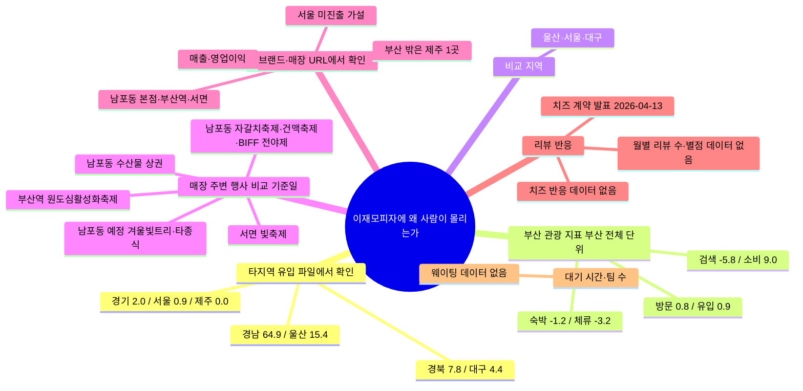

# 부산 지역 키워드 맵 · 이재모피자에 사람이 몰리는 이유

> 기준일: 2026-11-13. `prompts/01-keyword-map.md`의 세 칸(목적·우선순위·제외 조건)으로 만들었고, 같은 날 [3]②를 고친 뒤 다시 만들었습니다.
> CSV 근거는 `inputs/`에서 직접 읽었습니다. 행 번호는 머리글을 뺀 **데이터 행 번호**입니다. 단, '상권·점포' 묶음은 **엑셀 행 번호**(머리글 = 1행)이고, 파일은 `inputs/` 밖 프로젝트 루트에 있습니다.
> 기사 2건(비즈워치, 위키트리)은 2026-11-13 이번 작업에서 원문을 열어 확인했습니다. 기사가 보도한 수치이며 공시(DART)와는 아직 대조하지 않았습니다.
> 관광 지표의 기간 2025-11~2026-10은 `SOURCE.md` 기록을 따른 것이고, CSV 안에는 기간 컬럼이 없습니다.

## 가운데 질문

이재모피자에는 왜 사람이 몰리는가(웨이팅, 리뷰 반응, 관광객 방문)? 지금 가진 데이터로 **말할 수 있는 것**(부산으로 들어오는 타지역 방문 흐름, 부산 전체 관광 지표, 매장 주변 행사 날짜, 기사에 보도된 법인 실적)과 **말할 수 없는 것**(웨이팅 시간, 리뷰 반응, 20~30대 비중, 한 가게나 한 행사가 방문에 미친 효과)을 나눈다.

## 적용한 기준

| 칸 | 이 표에서 적용한 방식 |
|---|---|
| [2]① 근거 | `inputs/` 행 번호로 댈 수 있는 키워드를 먼저 올림. 그다음 URL, 마지막으로 `inputs/` 밖 루트 CSV |
| [2]② 시점 | 2026년에 나왔거나 지금(2026-11-13)도 유효한 것. 매장 주변 행사는 2025-11 이후 열렸거나 열릴 것 |
| [2]③ 트랙 연결 | 키워드마다 이어질 산출물(수요 예측, 원격 대기 앱 등)을 '왜 골랐나'에 적음 |
| [3] 타깃 | 주말·연휴에 오는 타지역 20~30대 관광객. **`inputs/`에는 나이·요일 컬럼이 없어** 20~30대·주말로 좁힐 수 없음 |
| [3]② 예외 | 매장이 있는 남포동(중구)·부산역(동구)·서면(부산진구) 근처 행사 7개를 '매장 주변 행사'로 남김. 나머지 축제 39행은 '뺀 것'으로 |

## 근거 등급

| 상태 | 뜻 |
|---|---|
| 파일에서 확인 | CSV의 해당 행에서 값을 직접 읽음 |
| URL에서 확인 | 2026-11-13에 원문 페이지를 직접 열어 확인함. 기사 보도치이며 공시와는 대조 전 |
| 확인 필요 | 파일·URL 근거가 없거나 일부만 확인됨 |
| 가설 | 회사·기관이 밝히지 않은 이유 |

## 키워드 표

| 묶음 | 분류 | 키워드 | 왜 골랐나 (셀 수 있는 것·분모 / 트랙 연결) | 근거 (CSV 데이터 행 또는 URL) | 노트 | 상태 |
|---|---|---|---|---|---|---|
| 타지역 → 부산 유입 | 산업 | 경남 → 부산 | 64.9. 유입 15개 행(데이터 행 1~15)의 합이 100.0이라 부산 유입 전체 중 비중으로 보임. → 수요 예측에서 '가까운 지역 손님' 비중의 기준값 | `inputs/datalab_related_regions.csv` 데이터 행 1 | `2026-11-12-gyeongnam-to-busan.md` · 분모(방문자 수, 통신 기록 등)는 원본에서 확인 필요 | 파일에서 확인 |
| 타지역 → 부산 유입 | 산업 | 울산 → 부산 | 15.4. 경남과 합쳐 유입의 80.3% | `inputs/datalab_related_regions.csv` 데이터 행 2 | 같은 분모 가정 | 파일에서 확인 |
| 타지역 → 부산 유입 | 산업 | 경북 → 부산 | 7.8 | `inputs/datalab_related_regions.csv` 데이터 행 3 | 같은 분모 가정 | 파일에서 확인 |
| 타지역 → 부산 유입 | 산업 | 대구 → 부산 | 4.4. 유사지역(대구)이기도 함 | `inputs/datalab_related_regions.csv` 데이터 행 4 | 같은 분모 가정 | 파일에서 확인 |
| 타지역 → 부산 유입 | 산업 | 경기 → 부산 | 2.0. 수도권 중 가장 큰 유입 | `inputs/datalab_related_regions.csv` 데이터 행 5 | 같은 분모 가정 | 파일에서 확인 |
| 타지역 → 부산 유입 | 산업 | 서울 → 부산 | 0.9. '서울에 매장이 없어서 부산까지 간다'는 이야기에 가장 직접 관련된 행. → 원격 대기 앱의 '멀리서 오는 손님' 규모 가늠 | `inputs/datalab_related_regions.csv` 데이터 행 7 | 부산 방문 전체의 비중이며 이재모피자 방문객과 무관. 이 값만으로 서울 수요를 단정하지 않음 | 파일에서 확인 |
| 타지역 → 부산 유입 | 산업 | 제주 → 부산 | 0.0. 부산 밖 유일한 매장(제주점)이 있는 지역 | `inputs/datalab_related_regions.csv` 데이터 행 15 | 반올림으로 0.0이 됐을 수 있음. 제주점 효과의 근거로 쓰지 않음 | 파일에서 확인 |
| 부산 관광 지표 | 산업 | 방문자 증감률(광역) | 0.8. 부산 전체 단위이며 방문자 **수가 아님**. → 수요 예측의 외부 변수 후보 | `inputs/datalab_visitors.csv` 데이터 행 1 | 같은 행의 기초지자체 칸이 비어 있어 중구(남포동) 값은 없음 | 파일에서 확인 |
| 부산 관광 지표 | 산업 | 방문자유입 | 0.9. 위의 0.8과 이름이 비슷하지만 **같은 지표로 보지 않음** | `inputs/datalab_diagnosis.csv` 데이터 행 1 | 두 지표의 정의 차이는 데이터랩 원본에서 확인 필요 | 파일에서 확인 |
| 부산 관광 지표 | 산업 | 숙박방문자 | -1.2. 당일치기와 숙박 방문을 가르는 지표. → 웨이팅 시간대(당일치기 손님은 귀가 시간에 쫓김) 가설과 연결 | `inputs/datalab_stay.csv` 데이터 행 1(증감률), `inputs/datalab_diagnosis.csv` 데이터 행 2(비율) | 값은 같지만 이름이 '증감률'과 '비율'로 다름. 단위 확인 필요 | 파일에서 확인 |
| 부산 관광 지표 | 산업 | 체류시간 | -3.2. 방문 증가와 방향이 반대. → 원격 대기 앱: 짧게 머무는 손님일수록 줄 서는 시간이 아까움 | `inputs/datalab_stay.csv` 데이터 행 1, `inputs/datalab_diagnosis.csv` 데이터 행 3 | 가설: 짧게 들르는 방문이 늘었을 수 있음. 이 파일만으로는 확인할 수 없음 | 파일에서 확인 |
| 부산 관광 지표 | 산업 (부: 문화) | 목적지 검색량 | -5.8. 검색 관심도는 실제 방문과 다른 지표 | `inputs/datalab_diagnosis.csv` 데이터 행 4 | '이재모피자' 검색량이 아니라 부산 목적지 전체의 검색량 | 파일에서 확인 |
| 부산 관광 지표 | 산업 | 관광소비 | 9.0. 지표 다섯 개 중 가장 큰 증가 | `inputs/datalab_diagnosis.csv` 데이터 행 5 | 이재모피자의 효과를 분리해 보여 주지 않음 | 파일에서 확인 |
| 비교 지역 | ? | 유사지역(울산·서울·대구) | 리뷰·웨이팅 데이터를 모은 뒤 부산과 비교할 대조군 후보 | `inputs/datalab_similar_regions.csv` 데이터 행 1~3 | 선정 기준이 파일에 없음 | 파일에서 확인 (기준은 확인 필요) |
| 매장 주변 행사 · 남포동 | 문화 (부: 자연) | 부산자갈치축제 | 2026-10-15~2026-10-18, 자갈치시장+유라리광장(중구 자갈치해안로 52). 본점이 있는 남포동 바로 옆 4일짜리 행사. 셀 것: 축제 4일과 그 앞뒤 주말의 리뷰 수·대기 시간. → 수요 예측의 '행사' 변수 | `inputs/busan_festivals.csv` 데이터 행 29 | 홈페이지 주소 칸이 비어 있음 | 파일에서 확인 |
| 매장 주변 행사 · 남포동 | 문화 (부: 산업) | 유라리 건맥축제 | 2026-09-04~2026-09-05, 유라리광장+남포동건어물도매시장(중구). 남포동 안에서 열린 먹거리 행사 | `inputs/busan_festivals.csv` 데이터 행 23 | 홈페이지 주소 칸이 비어 있음 | 파일에서 확인 |
| 매장 주변 행사 · 남포동 | 문화 | 부산국제영화제 전야제 | 2026-10-05, BIFF광장 일원(중구 비프광장로 36). 하루짜리라 '그날 줄이 길었나'를 비교하기 쉬움 | `inputs/busan_festivals.csv` 데이터 행 28 | 파일에 적힌 URL(biff.kr)은 이번에 열어 보지 않음 | 파일에서 확인 |
| 매장 주변 행사 · 남포동 | 문화 | 광복로겨울빛트리축제 | 2026-12-04~2027-01-31, 광복로 및 중구 관내 일원. 앞으로 열릴 행사라 웨이팅을 직접 관찰할 수 있는 시점. → 원격 대기 앱 현장 조사 시점 후보 | `inputs/busan_festivals.csv` 데이터 행 44 | 홈페이지 주소 칸이 비어 있음. 올해 개최 여부는 중구청 공지로 확인 필요 | 파일에서 확인 (개최 여부는 확인 필요) |
| 매장 주변 행사 · 남포동 | 커뮤니티 (부: 역사) | 부산시민의종 타종식 | 2026-12-31, 용두산공원(중구). 연말 하루 원도심으로 사람이 몰리는 시점 | `inputs/busan_festivals.csv` 데이터 행 45 | 파일에 적힌 URL(festivalbusan.com)은 이번에 열어 보지 않음 | 파일에서 확인 |
| 매장 주변 행사 · 부산역 | 커뮤니티 (부: 문화) | 부산원도심활성화축제 | 2026-05-22~2026-05-24, 부산역광장(동구 중앙대로 210). 부산역점 주변 행사. 치즈 발표(2026-04-13) 뒤라 비교할 때 두 사건이 섞이지 않게 주의 | `inputs/busan_festivals.csv` 데이터 행 15 | 부산역점의 정확한 위치는 확인하지 못함 | 파일에서 확인 |
| 매장 주변 행사 · 서면 | 문화 | 서면 빛축제 | 2025-10-13~2026-02-18, 서면1번가(부산진구). 2025-11 이후 기간과 겹치는 서면점 주변의 긴 행사. 셀 것: 행사 기간과 그 밖 기간의 월별 리뷰 수 | `inputs/busan_festivals.csv` 데이터 행 1 | 시작일은 2025-10이지만 기간 대부분이 2025-11 이후라 남김. 서면점 주소는 확인하지 못함 | 파일에서 확인 |
| 브랜드·매장 | 산업 (부: 역사) | 남포동 본점·부산역·서면 | 매장이 있는 곳 = 줄이 생기는 곳. 셀 것: 매장 수·위치 | [비즈워치 2026-04-13](https://news.bizwatch.co.kr/article/consumer/2026/04/10/0035): 1992년 부산 남포동에서 시작, "최근에는 부산역과 서면으로 지점을 확장" | 매장 주소·좌표는 확인하지 못함 | URL에서 확인 |
| 브랜드·매장 | 산업 | 부산 밖 매장은 제주 1곳 | '부산에 가야 먹는' 조건이 성립하는지 본다 | 비즈워치(위 URL): "부산이 아닌 제주에 딱 한 개의 매장을 갖고 있죠" | 제주점 개점일은 기사에 없음 | URL에서 확인 (개점일은 확인 필요) |
| 브랜드·매장 | 산업 | 법인 매출 추이 | 167억 → 337억 → 461억원(2023~2025). 분모는 **법인 전체**이며 매장별 수치가 아님. → 수요 예측의 연 단위 기준선 | 비즈워치(위 URL) | 2025년은 기사의 '지난해'를 기사일(2026-04) 기준으로 읽은 것. DART 미대조 | URL에서 확인 |
| 브랜드·매장 | 산업 | 영업이익·이익률 | 영업이익 40억원(2023) → 127억원(2025), 이익률 27.6%(2025) | 비즈워치(위 URL) | 2024년 영업이익과 이익률 산식은 기사에 없음 | URL에서 확인 |
| 브랜드·매장 | 산업 | 서울 미진출 이유 | 가설: 서울 임대료 부담, 직영 체제·지역 공급망 활용 때문. 회사 발언이 아니라 **기자의 분석** | 비즈워치(위 URL) | 회사가 직접 밝힌 이유는 기사에 없음 | 가설 |
| 리뷰 반응 | 산업 | 치즈 공급 계약 발표 | 리뷰를 발표 전후로 나눌 기준일 후보. 2026-04-13에 사푸토사와 개발한 치즈의 국내 독점 공급 계약 공증을 마쳤다고 보도됨. → 리뷰 분석의 전후 비교 기준 | [위키트리 2026-04-14](https://www.wikitree.co.kr/articles/1131509) | **발표일과 매장 실제 적용일은 다를 수 있음.** 회사 입장: "최상급 재료를 고집하는 브랜드 철학" | URL에서 확인 (적용일은 확인 필요) |
| 리뷰 반응 | 커뮤니티 (부: 산업) | 치즈 변화에 대한 반응 | 기사에는 "기존 임실 치즈 특유의 풍미를 그리워하는 목소리"와 "차별화되는 깊은 맛이 유지되고 있다"는 반응이 함께 서술됨. 분자: '치즈' 언급 리뷰 수 / 분모: 같은 기간 전체 리뷰 수 | 위키트리(위 URL). 비율 근거는 **리뷰 데이터 없음** | 기사 서술은 비율이 아님 | 확인 필요: 데이터 없음 |
| 리뷰 반응 | 커뮤니티 (부: 산업) | 월별 리뷰 수·별점 | 관심도의 대리 지표(방문객 수와 다름). → 수요 예측의 목표 변수 후보 | 리뷰 데이터 없음 | 만족하거나 화난 사람이 리뷰를 더 쓰는 편향 | 확인 필요: 데이터 없음 |
| 웨이팅 | ? | 대기 시간·대기 팀 수 | 질문의 핵심. 셀 것: 요일·시간대별 대기 시간, 특히 위 '매장 주변 행사' 날과 평소 주말 비교. → 원격 대기 앱 아이디어 | 웨이팅 데이터 없음. 확인한 기사 2건에도 이재모피자 웨이팅 언급 없음(비즈워치는 "줄을 서서 … 피자를 먹는" 맛집 순례 일반만 언급) | 아래 '앞으로 모아야 할 데이터' 참고 | 확인 필요: 데이터 없음 |
| 상권·점포 | 산업 (부: 커뮤니티) | 중구 남포동 · 수산물 소매업 | 50곳 / 466 = 10.73%. 이재모피자 본점과 같은 남포동이고, 자갈치축제가 열리는 시장 상권 | `busan_commercial_highlights.csv` 엑셀 행 168 | `inputs/` 밖 파일. `research/2026-11-12-상권-업종집중-동.md` | 파일에서 확인 |

> 유입 행 중 데이터 행 6, 8~14(전남광주·충북·전북·충남·대전·인천·강원·세종, 각 1.6 이하)는 제외 조건에 걸리지 않았지만 비중이 작아 표에 따로 올리지 않았습니다.
> 소수 값은 CSV에 적힌 그대로 옮겼습니다. 이 지표들은 모두 **부산 전체** 단위이므로, 이재모피자가 관광 변화를 일으켰다는 근거가 되지 않습니다.
> 데이터랩 행은 피자·맛집·웨이팅 언급이 없지만, [1]의 '관광객 방문'과 [3]의 '타지역 관광객'을 직접 다루는 지표라 [3]① '일반 부산 관광 행(해수욕장, 축제 등)'에는 넣지 않았습니다.
> 매장 주변 행사는 **비교할 날짜**로만 씁니다. 축제가 열렸다는 사실만으로 매장 방문이나 웨이팅이 늘었다고 단정하지 않습니다.

### 분류 까닭

1. 경남 → 부산 · 산업: 부산으로 들어오는 방문 비율이라 관광 수요(관광산업)의 기초값임.
2. 울산 → 부산 · 산업: 1과 같은 관광 유입 지표.
3. 경북 → 부산 · 산업: 1과 같은 관광 유입 지표.
4. 대구 → 부산 · 산업: 1과 같은 관광 유입 지표. 유사지역이라는 점은 분류를 바꾸지 않음.
5. 경기 → 부산 · 산업: 1과 같은 관광 유입 지표.
6. 서울 → 부산 · 산업: 1과 같은 관광 유입 지표. '서울에 매장이 없다'는 연결도 매장 전략(산업) 쪽임.
7. 제주 → 부산 · 산업: 1과 같은 관광 유입 지표. 제주점 연결도 매장 전략임.
8. 방문자 증감률(광역) · 산업: 관광 방문 규모의 변화를 재는 관광산업 지표.
9. 방문자유입 · 산업: 관광 방문 지표.
10. 숙박방문자 · 산업: 숙박업과 바로 이어지는 관광 지표.
11. 체류시간 · 산업: 관광객 행동 지표이며 원격 대기 앱(서비스) 근거로 쓰임.
12. 목적지 검색량 · 산업 (부: 문화): 관광 수요의 선행 지표. 무엇이 알려졌는지 보여 주는 관심도라 문화에도 걸침.
13. 관광소비 · 산업: 돈이 쓰인 규모를 재는 지표.
14. 유사지역(울산·서울·대구) · ?: 비교군 목록이라 그 자체로는 주제가 없음. 데이터랩이 어떤 기준(관광·산업·인구)으로 골랐는지 모자람.
15. 부산자갈치축제 · 문화 (부: 자연): 지역 축제라 문화. 바다·수산물 시장을 무대로 해서 자연에 걸침.
16. 유라리 건맥축제 · 문화 (부: 산업): 지역 축제라 문화. 건어물 도매시장 상권 행사라 산업에 걸침.
17. 부산국제영화제 전야제 · 문화: 영화제 행사. 다른 분류에 걸칠 근거 없음.
18. 광복로겨울빛트리축제 · 문화: 빛 장식 축제. 다른 분류에 걸칠 근거 없음.
19. 부산시민의종 타종식 · 커뮤니티 (부: 역사): 시민이 모여 새해를 맞는 행사라 커뮤니티. 해마다 이어 온 의식이라 역사에 걸침.
20. 부산원도심활성화축제 · 커뮤니티 (부: 문화): 원도심 지역 살리기가 목적이라 커뮤니티. 축제 형식이라 문화에 걸침.
21. 서면 빛축제 · 문화: 빛 시설물 축제. 파일에 '시민참여 프로그램'이 있지만 중심은 전시라 커뮤니티로 걸치지 않음.
22. 남포동 본점·부산역·서면 · 산업 (부: 역사): 매장 입지라 산업. 1992년 남포동에서 시작한 가게 내력이 있어 역사에 걸침.
23. 부산 밖 매장은 제주 1곳 · 산업: 매장 확장 전략.
24. 법인 매출 추이 · 산업: 기업 실적.
25. 영업이익·이익률 · 산업: 기업 실적.
26. 서울 미진출 이유 · 산업: 임대료·직영 체제·공급망이라는 경영 판단.
27. 치즈 공급 계약 발표 · 산업: 원재료 공급 계약.
28. 치즈 변화에 대한 반응 · 커뮤니티 (부: 산업): 손님들이 내놓은 반응이 중심이고, 대상은 제품 변화(산업).
29. 월별 리뷰 수·별점 · 커뮤니티 (부: 산업): 손님이 남긴 평가이며 수요 예측 변수로도 쓰임.
30. 대기 시간·대기 팀 수 · ?: 손님 행동(커뮤니티)으로 볼지 매장 운영(산업)으로 볼지 정할 수 없음. 웨이팅 데이터도, 무엇을 볼지 정한 기획 목적도 모자람.
31. 중구 남포동 · 수산물 소매업 · 산업 (부: 커뮤니티): 소매 점포 수 지표. 같은 구의 자갈치시장·신동아수산물종합시장 같은 시장 공동체와 이어짐.

## 뺀 것

| 뺀 행·키워드 | 이유 |
|---|---|
| `busan_festivals.csv` 데이터 행 2~4 (장림항 부네치아 아트프리마켓, 감천문화마을 골목축제, UN평화축제) | 2025년에 끝난 행사이고 매장 근처(중구·동구·부산진구)도 아님. [3]② |
| `busan_festivals.csv` 데이터 행 5~13, 16, 19~22, 24~26, 30~31, 33~40, 42~43 | 매장 근처가 아닌 곳(해운대·수영·기장·사하·금정·서구 등)의 일반 관광 행사. 피자·맛집·웨이팅 언급 없음. [3]① |
| `busan_festivals.csv` 데이터 행 46 (2027 정월대보름 달집태우기, 금정구) | 아직 열리지 않았지만 매장 근처가 아닌 일반 관광 행사. [3]① |
| `busan_festivals.csv` 데이터 행 18(부산항축제, 동구 북항친수공원), 41(영도다리축제, 영도구 봉래동물양장) | 원도심과 가깝지만 매장(남포동·부산역·서면) 근처인지 확인하지 못함. 매장 주소를 확인하면 다시 검토. [3]② 예외에 못 넣음 |
| `busan_festivals.csv` 데이터 행 14(해운대모래축제), 17(제24회광안리어방축제), 27(부산국제록페스티벌), 32(동래읍성역사축제) | 먼저 나온 행 12·16·26·31과 같은 축제의 중복 행. [3]③ (원래 행도 매장 근처가 아니라 위에서 뺌) |
| `busan_festivals.csv` 중 '먹거리장터'·'푸드라운지'가 적힌 행(데이터 행 11, 22, 25, 27, 30, 35, 37) | 먹거리 언급은 있지만 피자·맛집·웨이팅 언급은 아니고 매장 근처도 아님. [3]① |
| `busan_commercial_highlights.csv` 엑셀 행 137(부전2동 여성 의류), 152(범일2동 액세서리/잡화), 167(부전1동 수산물), 182(기장읍 건어물/젓갈), 242·243(민락동·광안2동 펜션), 257(우1동 호텔/리조트), 272(중앙동 여행사), 287(우3동 수상/해양 레저) | 피자·맛집·웨이팅과 관계없는 업종 집중 행. [3]① |
| `busan_markets.csv` 부산진구 전통시장 26곳·점포 4,684, 엑셀 행 130(부산진시장 점포 1,050) | 위 상권 행(137·152)의 보조 근거였으므로 함께 뺌. [3]① |
| `datalab_related_regions.csv` 데이터 행 16~30 (유출) | 부산 사람이 다른 지역으로 나가는 흐름이라, 타지역 관광객이라는 타깃과 반대. [3] 타깃 |
| 광고·협찬 표시 블로그·리뷰 행 | `inputs/`에 블로그·리뷰 행이 없어 해당 행 없음. [3]④ |
| "부산 여행 필수 코스 1위"(위키트리 기사 제목) | 순위 기준·조사 주체·분모가 기사에 없음. [2]① |
| 20~30대·주말 방문 비중 | `inputs/` 어느 파일에도 나이·요일 컬럼이 없음. 꾸며 내지 않음 |
| "관광소비가 9.0 늘었으니 이재모피자 덕분" | 부산 전체 지표로 한 가게의 효과를 단정하는 설명 |
| 중구·남포동 단위 방문 지표 | `datalab_visitors.csv` 데이터 행 1의 기초지자체 칸이 비어 있음 |

## 앞으로 모아야 할 데이터

| 데이터 | 항목 | 기간 | 출처 | 약관 확인 |
|---|---|---|---|---|
| 웨이팅 | 매장·요일·시간대별 대기 시간, 대기 팀 수 | 주말·연휴 포함 최소 4주. 광복로겨울빛트리(2026-12-04~)·타종식(2026-12-31) 기간 포함 | 현장 관찰, 원격 줄서기 앱 공개 화면 | 아직 안 함 |
| 리뷰 | 작성일, 별점, 리뷰 텍스트, 매장(본점·부산역·서면·제주), 광고·협찬 표시 여부. 작성자 이름은 저장하지 않음 | 최소 2025-10~2026-10 (치즈 발표일 2026-04-13 앞뒤 6개월, 자갈치축제·BIFF 전야제 포함) | 지도 앱, 맛집 앱, 블로그 | 아직 안 함. 서비스별로 수집 전에 확인 |
| 매장 주소 | 본점·부산역점·서면점 도로명 주소, 좌표 | 현재 | 업체 공지, 지도 앱 | 해당 없음 |
| 치즈 매장 적용일 | 매장별 새 치즈 적용 시작일 | 2026-04 전후 | 업체 공지, 후속 기사 | 해당 없음 |
| 제주점 개점일 | 개점 연월일 | 미확인 | 업체 공지, 기사 | 해당 없음 |
| 법인 실적 | 매출, 영업이익, 영업이익 산식 | 2023~2025 | DART 에프지케이 감사보고서(공시 여부부터 확인) | 해당 없음 |
| 중구 단위·연령별 관광 지표 | 중구 방문자 증감률, 20~30대 비중 | 2025-11~2026-10 | 한국관광 데이터랩에서 기초지자체 '중구'·연령 조건으로 다시 다운로드 | 이용 조건 확인 |

## 키워드 사이 연결

